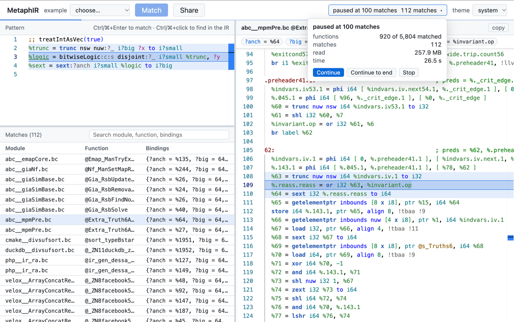

# MetaphIR Matcher

<https://xuhongxu.com/metaphir-site/>

## Check How Often an IR Pattern Occurs in Real Code --- In Your Browser



When you write or review an [InstCombine](https://llvm.org/doxygen/classllvm_1_1InstCombiner.html) fold,
one question is whether the pattern it matches shows up in real programs at all.
Answering it usually means writing a matcher, building LLVM, and running it over a corpus of IR.

MetaphIR is a small pattern language for LLVM IR, and the MetaphIR Matcher runs it in the browser
against an indexed snapshot of real-world IR from [llvm-opt-benchmark-nightly](https://github.com/dtcxzyw/llvm-opt-benchmark-nightly).

Write a pattern, hit **Match**, and see every function in the corpus that contains it.

> Announcement on the LLVM Discourse:
> [A web-based matcher for checking how often an IR pattern occurs in real code](https://discourse.llvm.org/t/a-web-based-matcher-for-checking-how-often-an-ir-pattern-occurs-in-real-code/92539)

## The pattern language

A pattern is LLVM IR with meta variables (`?x`) and constraints (lines starting with `;;`).
It matches functions that contain these instructions.

```llvm
; (X u/ 2) + (X u% 2), in either order
%div = udiv i?n ?x, 2
%rem = urem i?n ?x, 2
%sum = add:c i?n %div, %rem
;; ugt(?n, 1) && isKnownNonZero(?x)
```

- **Meta variables** --- `?x` binds a value, a type, an integer width, a predicate, a flag, a callee, and so on.
  A meta variable used twice binds one thing: `mul i32 ?x, ?x` squares a value.
- **Meta flags** --- `:c` matches the operands in either order, `:s` requires a single use,
  and flags on operands such as `:knownPowerOfTwo` say what the operand must be.
- **Constraints** --- conditions on the bindings, such as `noOverflow("umul", ?y, ?z)`.

For example, the fold `(X udiv Y) udiv Z --> X udiv (Y * Z)` from [#214541](https://github.com/llvm/llvm-project/pull/214541)
is written in InstCombine as

```cpp
match(Op0, m_OneUse(m_UDiv(m_Value(X), m_Value(Y)))) &&
    willNotOverflowUnsignedMul(Y, Op1, I)
```

and in MetaphIR as

```llvm
%d = udiv i?n ?x, ?y
%r = udiv i?n %d:s, ?z
;; noOverflow("umul", ?y, ?z)
```

The **Help** button on the site walks through the syntax and semantics with examples,
and the **example** dropdown loads patterns of folds from recent LLVM pull requests.

## What you get

- **Matches** --- every matching function, with its module and the bindings of the meta variables.
  You can search them by module, function, or binding.
- **IR view** --- click a match to see its function with the matched instructions highlighted.
- **Statistics** --- how many functions matched out of how many were scanned.
  A broad search pauses every 100 matches, so you can stop early or continue to the end.
- **Share** --- a link that opens the matcher with your pattern.

## Notes

- The index is downloaded on demand: about 100--600 MB for a broad query.
  The cache is incremental, so the first queries are slow and later ones are faster.
- MetaphIR is an early research prototype, and its syntax is still changing.
  Feedback is welcome on the [Discourse thread](https://discourse.llvm.org/t/a-web-based-matcher-for-checking-how-often-an-ir-pattern-occurs-in-real-code/92539).
